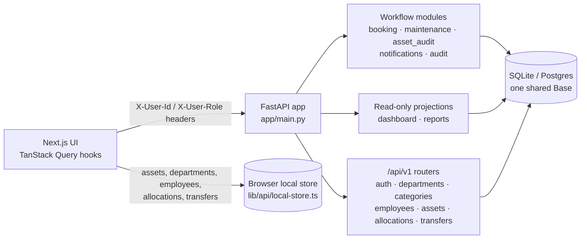

# AssetFlow

An asset and resource management system for organizations: departments, employees, physical assets, shared-resource bookings, maintenance workflows, physical audit cycles, notifications, activity logs, dashboards and reports.

AssetFlow is a **team hackathon project**. Its 27 commits were all made on 2026-07-12 by three committers, with a fourth contributor credited as a co-author in one commit. The backend is a set of self-contained FastAPI modules over one shared database, and the frontend is a Next.js App Router application.

> **Status: hackathon prototype.** The workflow modules and their 191 backend tests are solid, and the integrated application **now starts on a fresh database and serves the seeded estate end to end** — the two conflicting `assets` schemas have been reconciled into one ([Shared `assets` contract](#shared-assets-contract)). Authentication is still a demo seam, not real security.

## Who built what

Attribution comes from `git log` per directory:

| Area | Paths | Author(s) |
|---|---|---|
| Workflow modules: booking, maintenance, asset audit, notifications, activity log, dashboard, reports; their tests; the Next.js frontend; app integration | `backend/app/{booking,maintenance,asset_audit,notifications,audit,dashboard,reports}/`, `backend/tests/`, `frontend/` | Shivam Mishra |
| Organization and identity APIs: JWT auth, departments, categories, employees, roles | `backend/app/routers/`, `backend/app/models/` | Ankur Saini |
| Asset lifecycle APIs: assets, allocations, transfers | `backend/app/routers/`, `backend/app/models/` | Ranveer |

## Architecture



Each workflow module is a vertical slice with the same internal layout: `router.py` (HTTP), `service.py` (business rules), `validators.py`, `schemas.py` (Pydantic v2), `models.py` (SQLAlchemy 2), `exceptions.py` and `deps.py`; modules that read assets also have a `gateway.py`. Each exposes `register_routes(app)`, and [`app/main.py`](backend/app/main.py) mounts them all.

| Module | Prefix | Responsibility |
|---|---|---|
| Booking | `/api/bookings` | Reservation lifecycle (approve, reject, check out, check in, cancel) with overlap detection |
| Maintenance | `/api/maintenance` | Request → approve → assign → start → resolve |
| Asset audit | `/api/asset-audit` | Audit cycles, asset enrolment, verification, discrepancy reports |
| Notifications | `/api/notifications` | Per-recipient inbox used by the other modules |
| Activity log | `/api/audit` | Append-only audit trail |
| Dashboard | `/api/dashboard` | Read-only KPI and aggregation projections |
| Reports | `/api/reports` | Tabular reports with CSV/PDF export |

**Design choices**

- **No cross-module ORM imports.** Modules reach assets only through an `AssetGateway` over a minimal string-keyed `assets` contract (`id`, `name`, `status`, `department_id`). This kept modules independently testable while different people built them in parallel.
- **Double-booking prevention.** [`booking/service.py`](backend/app/booking/service.py) checks for active bookings on the same asset whose window overlaps `[start, end)`, both on create and on reschedule.
- **Split persistence in the UI.** Assets, departments, employees, categories, allocations and transfers are stored in a seeded browser local store. Bookings, maintenance, audits, notifications, the activity log, the dashboard and reports are served by the backend. The backend seeds `AST-0001…AST-0016` to match the UI's asset IDs.

## Running it

Prerequisites: Python 3.9+ and Node.js 18+.

### Backend tests (verified)

```bash
cd backend
pip install -r requirements.txt pytest httpx
python -m pytest tests -q
```

Run `pytest` on `tests/`, not on the whole directory: `backend/test_api.py` is a manual smoke script for a running server and needs `requests`, so collecting it fails.

### Backend server

```bash
cd backend
uvicorn app.main:app --reload --port 8000     # interactive docs at /docs
```

Starting against an empty database creates every table and seeds the sixteen demo assets (`AST-0001`…`AST-0016`), the same ids the UI shows.

### Frontend

```bash
cd frontend
npm install
cp .env.example .env.local     # NEXT_PUBLIC_API_BASE_URL=http://localhost:8000
npm run dev                    # http://localhost:3000
npm run typecheck && npm run build
```

Demo accounts, all defined client-side in [`frontend/src/lib/auth/session.ts`](frontend/src/lib/auth/session.ts):

| Role | Email | Password |
|---|---|---|
| Administrator | `admin@assetflow.io` | `admin123` |
| Asset Manager | `manager@assetflow.io` | `manager123` |
| Technician | `tech@assetflow.io` | `tech123` |
| Employee | `employee@assetflow.io` | `employee123` |

The dashboard and activity log are restricted to the Asset Manager and Administrator roles.

## Verification

| Check | Result | How it was established |
|---|---|---|
| `python -m pytest tests -q` (booking, maintenance, asset audit, notifications, activity log, dashboard, reports, cross-module integration) | 191 passed | Run locally on 2026-10-28, Python 3.12, clean virtualenv |
| Application startup on an empty SQLite database | **Passes** — 16 assets seeded, `/docs` and `/openapi.json` return 200 | Run on 2026-10-29 by starting the app's lifespan with FastAPI's `TestClient` against a deleted database |
| End-to-end booking against a seeded asset | Booking created (201); an overlapping window is refused (409); an unknown asset id is refused (404); `/api/dashboard/overview` and `/kpis` return 200 | Same run, through the mounted application rather than a module fixture |
| Frontend `typecheck` and `build` | Not run | — |
| `/api/v1` routers (auth, departments, assets, …) | No automated tests | — |

There is no CI configuration in this repository.

## Shared `assets` contract

Two parts of the backend used the table name `assets` with different shapes: the
`/api/v1` ORM model keyed it on an autoincrementing integer, while the workflow
modules read it through their `AssetGateway` against a string-keyed contract
(`id`, `name`, `status`, `department_id`) — the same string ids the frontend
store uses. `create_all` built the integer version, the seed then wrote string
ids and a `department_id` column that version did not have, and startup died.

They now agree on one schema, owned by [`app/models/asset.py`](backend/app/models/asset.py):

- **`id` is a string** (`AST-0001`), matching the gateway contract and the UI's ids. `asset_tag` carries the same value, and the generator for new assets continues from the highest number already in use rather than from a row count.
- **`department_id` is part of the model**, so `create_all` produces the column the gateways read.
- **`status` is lower-case snake_case** (`available`, `allocated`, `under_maintenance`, …) across both halves, so a status written through `/api/v1` is one the modules recognise.
- **`is_bookable`, `is_active` and `status` carry `server_default`s.** The table is shared with modules that write it through SQLAlchemy Core, so its invariants belong in the schema rather than only in the ORM layer.
- **`category_id` is nullable**, because an asset on the shared contract exists before the `/api/v1` category taxonomy does.

Foreign keys in `allocations`, `transfers` and `asset_history`, and the request
and response schemas that carry an asset id, follow the string key.

## Known issues

- **Authentication is not enforced.** The workflow modules trust `X-User-Id`/`X-User-Role` headers sent by the browser, and the login screen checks demo credentials in client-side code. The JWT routers under `/api/v1` hard-code their signing key in [`app/core/security.py`](backend/app/core/security.py), and the UI does not use them.
- **CORS allows all origins**, with credentials.
- **Two seeding paths and two startup hooks.** `main.py` calls `create_all` at import time and again in the lifespan hook, and also registers a deprecated `on_event("startup")` handler for role seeding.
- **Split source of truth.** Half of the domain data lives in the browser, so it is not shared between users or sessions.

## Project structure

```
backend/
  app/
    main.py            # mounts every module onto one app
    database.py        # shared Base / engine / session
    core/              # Role enum, auth seams (header principal + JWT helpers)
    seed.py            # seeds the assets contract table
    booking/ maintenance/ asset_audit/ notifications/ audit/ dashboard/ reports/
    routers/ models/ schemas/   # /api/v1 org, identity and asset-lifecycle APIs
  tests/               # per-module and cross-module tests
frontend/
  src/
    app/               # Next.js App Router pages
    components/        # UI, layout and shared components
    lib/api/           # client, endpoints, types, local store
    lib/hooks/         # TanStack Query hooks per module
```
